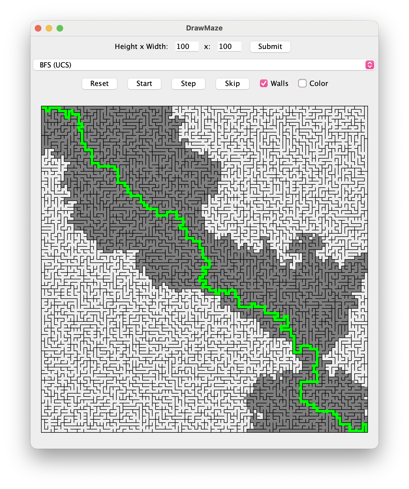
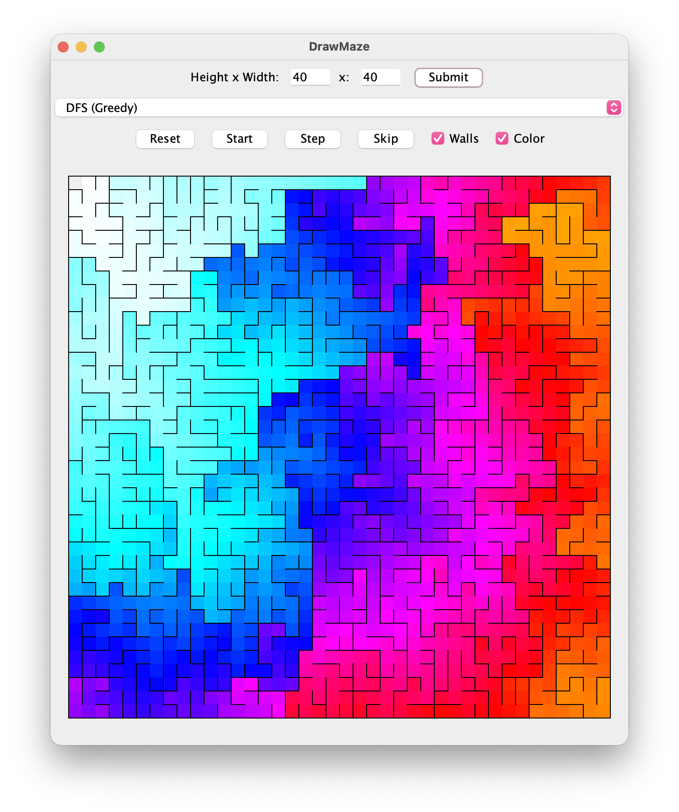
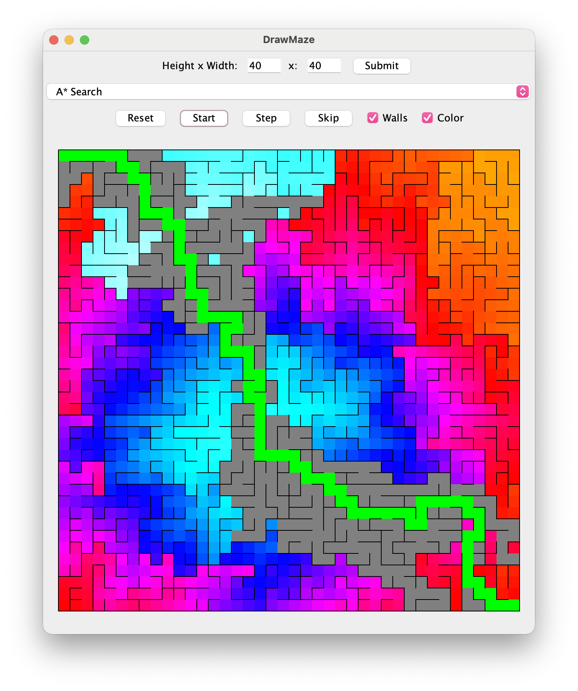

# Maze Solver

<p align="center">
  
</p>

A Java/Swing visualization tool for exploring maze generation and pathfinding algorithms.

It was originally designed as an educational tool for students, since it is much easier to understand algorithms such as A* when they can be seen exploring a maze in real time.

## Features

<table>
  <tr>
    <td></td>
    <td></td>
  </tr>
</table>

- Procedural maze generation with support for various maze-generation methods, defaults to Growing Tree Algorithm.
- Toggleable maze walls and search visualization.
- Multiple pathfinding algorithms (DFS, BFS, A*, UCS, Greedy). Weighted graphs are supported but not implemented by default.

## Algorithms

### Maze Generation

- Growing Tree

The Growing Tree generator uses a configurable probability to choose between a random active cell and the most recently added cell, producing different maze characteristics.

- Recursive Backtracker

The Recursive Backtracker algorithm uses depth-first search to construct the 
maze. It follows a path through unvisited cells, backtracking when it reaches 
a cell with no unvisited neighbors.

- Prim's Algorithm

Prim's algorithm builds the maze by maintaining a frontier of cells adjacent 
to the portion of the maze that has already been generated. A frontier cell 
is selected and connected to the existing maze until all cells have been added.

- Wilson's Algorithm

Wilson's algorithm uses loop-erased random walks to construct a uniform 
spanning tree. Random walks are performed through unvisited cells until they 
connect to the existing maze.

### Pathfinding

- Breadth-First Search (BFS)
- Depth-First Search (DFS)
- A* Search
- Uniform-Cost Search (UCS)
- Greedy Best-First Search

The GUI can animate the search process of any algorithm or advance it one step at a time.

## How to Run

### Requirements

- Java 17 or later
- Maven

### Using Maven

Clone the repository and run:

```bash
mvn test
```
This compiles the project and runs the automated test suite.

To create a Maven package:
```bash
mvn package
```
### Running

The application can be run with:
```bash
mvn exec:java -Dexec.mainClass="com.bryce_59.maze.ui.DrawMaze"
```

# Credits
- 2024 Bryce Richardson

# License
- [MIT License](https://choosealicense.com/licenses/mit/)
